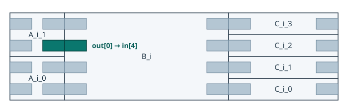

# Place blocks and pins

The pinning example places two copies of A beside B, then places four copies of C along B’s other edge. Each A drives four bits of B’s input. [Example source](https://github.com/xlsynth/topstitch/blob/99138be87453717c6868c18fb99f2a1c5f7ee3a3/examples/pinning.rs)



Look at the highlighted pair on metal layer M1. The upper A drives the high four bits of B’s input, so its `out[0]` meets `B_i.in[4]`. On M2, the same spot carries the next bit, from `A_i_1.out[1]` to `B_i.in[5]`.

## Build the highlighted boundary

The example defines its own pin grid. On both M1 and M2, the first horizontal track is at 10 and the pitch is 20. Each pin spans 10 units along the block edge and extends 20 units into the block.

```rust,ignore
let pin_shape = Polygon::from_bbox(&BoundingBox {
    min_x: -5,
    max_x: 5,
    min_y: 0,
    max_y: 20,
});
let mut track_definitions = TrackDefinitions::new();
let (offset, pitch) = (10, 20);
for layer in ["M1", "M2"] {
    track_definitions.add_track(TrackDefinition::new(
        layer, offset, pitch, TrackOrientation::Horizontal,
        Some(pin_shape.clone()), None,
    ));
}
```

Set A’s outline before assigning its tracks. The generator gives A, B, and C each a copy of the grid. Both instances of A share A’s outline and pin layout.

```rust,ignore
let a = ModDef::new("A");
a.set_shape(Polygon::from_width_height(50, 40));
a.set_track_definitions(track_definitions.clone());
```

Place each instance in the parent. The loop uses the same index to stack the A instances and choose which four bits of B each one drives. B starts at A’s right edge.

```rust,ignore
let b_inputs = b_instance.get_port("in").subdivide(a_instances.len());
for (i, a_inst) in a_instances.iter().enumerate() {
    a_inst.place((0, i as i64 * 40), Orientation::R0);
    a_inst.get_port("out").connect(&b_inputs[i]);
}
b_instance.place((50, 0), Orientation::R0);
```

Spread A’s inputs along the left edge, then place its outputs directly across from them. Setting the pins through the first instance updates A’s shared pin layout. Finally, `place_abutted()` follows B’s input connections to the placed A outputs. That’s how B’s input pin lands beside its partner in the picture.

```rust,ignore
a.get_port("in").spread_pins_on_left_edge(a.get_layers(), Default::default())?;
let first_a = &a_instances[0];
first_a.get_port("out").place_across_from(first_a.get_port("in"));
b_instance.get_port("in").place_abutted();
```

## View the placement in KLayout

With KLayout installed, run these commands from the repository root:

```sh
cargo run --locked --example pinning
klayout examples/output/pinning.def
```

KLayout loads the adjacent `pinning.lef` for the block shapes and pins. Show the full hierarchy and zoom in on the edge between `A_i_1` and `B_i`. In the layer list, show `M1.PIN` and `M1.LABEL` with the M2 layers hidden. Switch to the M2 pins and labels to see the other pair. [KLayout LEF/DEF reader options](https://www.klayout.de/doc/code/class_LEFDEFReaderConfiguration.html)

When emitting the layout, use `LefDefOptions` to check for overlapping instances (`check_for_instance_overlaps`), pins outside a block (`check_that_pins_are_contained`), or port bits missing a pin (`check_fully_pinned`).
